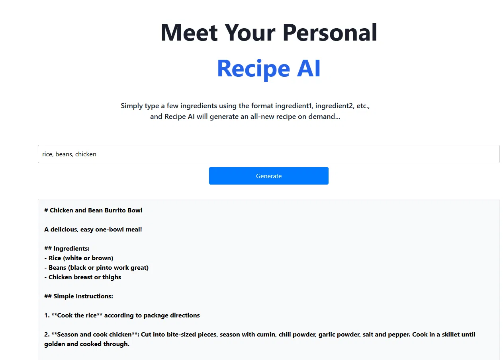

# 🍳 AI Recipe Generator

Uma aplicação web **serverless** com **IA generativa** que cria receitas a partir de uma lista de ingredientes. O usuário faz login, digita os ingredientes que tem em casa e a IA (Claude, via Amazon Bedrock) gera uma receita completa sob demanda.



---

## ✨ Funcionalidades

- 🔐 **Autenticação completa** — cadastro, login, verificação por e-mail e recuperação de senha (Amazon Cognito)
- 🤖 **Geração de receitas com IA** — a partir de ingredientes livres, a IA sugere um prato com ingredientes e modo de preparo
- ☁️ **Arquitetura 100% serverless** — sem servidores para gerenciar; cada serviço escala sob demanda
- 🚀 **CI/CD automático** — cada `git push` dispara build e deploy na AWS Amplify

---

## 🏗️ Arquitetura

```
┌─────────────┐     ┌──────────────┐     ┌──────────────┐     ┌─────────────────┐
│   React     │────▶│   Cognito    │────▶│   AppSync    │────▶│  Resolver JS    │
│  (frontend) │     │   (login)    │     │  (GraphQL)   │     │  (bedrock.js)   │
└─────────────┘     └──────────────┘     └──────────────┘     └────────┬────────┘
                                                                        │
                                                               ┌────────▼────────┐
                                                               │ Amazon Bedrock  │
                                                               │ (Claude Sonnet) │
                                                               └─────────────────┘
```

**Fluxo de um pedido de receita:**

1. O usuário se autentica via **Amazon Cognito**
2. Digita os ingredientes no frontend **React** e envia
3. A requisição chega à API **GraphQL (AWS AppSync)**, na query `askBedrock`
4. O **resolver** (`bedrock.js`) monta o prompt e chama a IA
5. O **Amazon Bedrock** invoca o modelo **Claude (Anthropic)**, que gera a receita
6. A resposta percorre o caminho inverso e é exibida na tela

Tudo é provisionado como código via **AWS Amplify (Gen 2)** — a infraestrutura (auth, dados, permissões) é declarada em TypeScript na pasta `amplify/`.

---

## 🛠️ Stack

| Camada | Tecnologia |
|---|---|
| Frontend | React + TypeScript + Vite |
| UI / Auth | AWS Amplify UI React |
| Autenticação | Amazon Cognito |
| API | AWS AppSync (GraphQL) |
| Lógica / IA | Resolver JS + Amazon Bedrock (Claude) |
| Infraestrutura como código | AWS Amplify Gen 2 |
| Hospedagem / CI-CD | AWS Amplify Hosting |

---

## 📂 Estrutura do projeto

```
ai-recipe-generator/
├── amplify/
│   ├── auth/resource.ts      # Configuração do Cognito (login por e-mail)
│   ├── data/resource.ts      # Schema GraphQL e query askBedrock
│   ├── data/bedrock.js       # Resolver: monta o prompt e trata a resposta da IA
│   └── backend.ts            # Data source do Bedrock e permissões IAM
├── src/
│   ├── App.tsx               # Tela principal e chamada à API
│   ├── main.tsx              # Autenticação (Authenticator)
│   └── App.css / index.css   # Estilos
├── amplify.yml               # Pipeline de build (frontend + backend)
└── README.md
```

---

## 🚀 Como rodar localmente

> Pré-requisitos: Node.js, uma conta AWS e credenciais configuradas (`npx ampx configure profile`).

```bash
# 1. Instalar dependências
npm install

# 2. Subir o backend em modo sandbox (cria os recursos na AWS)
npx ampx sandbox

# 3. Em outro terminal, rodar o frontend
npm run dev
```

Acesse `http://localhost:5173/`, crie uma conta e gere sua primeira receita.

---

## 📝 Nota técnica

Este projeto foi construído seguindo a arquitetura serverless da AWS com Amazon Bedrock. Alguns pontos de aprendizado documentados durante o desenvolvimento:

- **Inference profiles** — modelos recentes do Claude no Bedrock exigem o uso de *inference profiles* (prefixo `us.`) em vez da invocação direta pelo ID do modelo, além de permissões IAM nas regiões que o profile utiliza.
- **Build na nuvem vs. local** — o build de produção do Amplify usa TypeScript em modo estrito, o que exige `import type` para importações que são apenas tipos.
- **Acesso a modelos do Bedrock** — modelos da Anthropic podem exigir habilitação via AWS Marketplace na conta antes do primeiro uso.

A demonstração acima foi capturada com o app gerando receitas em ambiente de desenvolvimento.

---

## 👤 Autor

**Renan Simoes** — [@renanrodsimoes](https://github.com/renanrodsimoes)

---

## 📄 Licença

Projeto de estudo/portfólio, livre para uso e referência.
